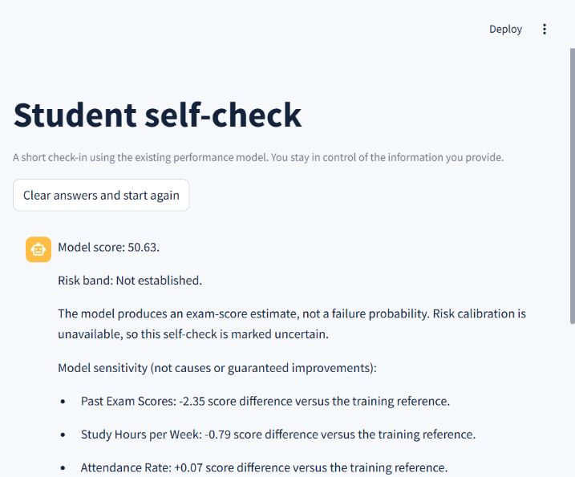

# Student Performance Predictor

A student self-check built with **Streamlit and a frozen scikit-learn model**. Students can answer through a chat-style interface or a plain form, review and correct their inputs, and receive a deterministic model estimate.

[Open the live app](https://surya-student-performance-predictor.streamlit.app/)

Deployed on Streamlit Community Cloud with Python 3.13. The consent, form, confirmation and scoring flow was verified with synthetic inputs on October 24, 2026.



## Features

- Consent before collecting information.
- Chat and form modes using one feature specification and scoring service.
- Rule-based handling of percentages and fractions such as `18/30`.
- Editable confirmation before any score is produced.
- Exact SHA-256 verification of the original trained model.
- Model-sensitivity explanations, labelled as associations rather than causes.
- Optional OpenAI structured extraction with local validation and offline fallback.
- No application database or transcript storage; logging is disabled by default.
- Local guards for personal information, instructions to change scores, guarantees and distress.

## What the result means

The existing model is a Random Forest **regressor** trained on a public demonstration dataset. It produces an exam-score estimate. It has no validated failure-probability calibration or Low/Medium/High risk mapping, so the app displays **Risk band: Not established** and marks the result uncertain.

The dataset's observed final scores ranged from 50 to 77. Performance on actual college students has not been established. Every result says that it is an estimate from limited self-reported data, not a prediction of the student's result, and directs the student to a mentor or faculty member.

## Run locally

Use **Python 3.13**. The original model is included byte-for-byte; no training or downloads are needed.

```bash
git clone https://github.com/chaudharysuryapratap/student-performance-predictor.git
cd student-performance-predictor
python -m venv .venv
```

Activate `.venv` using `.venv\Scripts\Activate.ps1` on Windows or `source .venv/bin/activate` on macOS/Linux, then:

```bash
python -m pip install -r requirements.txt
python -m streamlit run streamlit_app.py
```

Open the local URL printed by Streamlit. `streamlit run app/main.py` is an equivalent entry point.

The default `LLM_PROVIDER=none` is form-first and offline. Select Chat in the app to use local parsing, or set `LLM_PROVIDER=rules` before starting for chat-first offline mode. A hosted operator can set the root-level secret `LLM_PROVIDER = "rules"` for that same behavior.

## Deploy on Streamlit Community Cloud

1. Sign in at [share.streamlit.io](https://share.streamlit.io/) using the GitHub account with access to this repository.
2. Select **Create app** and use the repository `chaudharysuryapratap/student-performance-predictor`.
3. Set branch to **main** and main file path to **streamlit_app.py**.
4. In **Advanced settings**, choose **Python 3.13**. No API key is needed for offline mode.
5. Deploy and verify consent, form/chat collection, confirmation and the final estimate.

For a private repository, Streamlit must already have access to that repository. Keep any secrets in Streamlit's secrets settings, never in Git. See the [official deployment guide](https://docs.streamlit.io/deploy/streamlit-community-cloud/deploy-your-app/deploy).

## Model inputs

| Input | Accepted values |
|---|---|
| Study hours per week | Number from 0 to 168 |
| Attendance rate | Percentage from 0 to 100 |
| Past exam score | Percentage from 0 to 100 |
| Internet access at home | Yes / No |
| Extracurricular activities | Yes / No |

All inputs are required. Unknown values are re-asked rather than guessed. Names, roll numbers and contacts are not requested. The broad input limits do not establish training coverage.

## Configuration

The app reads process environment variables. `.env.example` is documentation and is not loaded automatically. Streamlit Community Cloud can expose root-level secrets as environment variables.

| Variable | Default | Purpose |
|---|---|---|
| LLM_PROVIDER | none | none, rules, mock or openai |
| OPENAI_MODEL | unset | A model supporting strict JSON-schema output |
| OPENAI_API_KEY | unset | Optional OpenAI extraction only |
| ENABLE_LOGGING | false | If enabled, logs validated numeric inputs only; consent discloses this |
| SUPPORT_MESSAGE | Generic support wording | Institution-reviewed distress response |
| RUN_LLM_INTEGRATION | false | Explicit opt-in for the live-provider test |

OpenAI mode sends only filtered academic tokens from the current answer. Provider suggestions require validation and independent local parsing evidence. No scores, transcripts, names or identity fields are sent. Provider failures fall back to the rule parser. Final replies and questions use fixed templates; generated final-result wording is disabled. Live provider quality has not been verified.

`core/feature_spec.yaml` and `core/bands.yaml` use JSON syntax, a valid subset of YAML. Questions, aliases and input bounds can be edited while preserving the frozen model's feature names, order and types. Band thresholds remain disabled until a reviewed calibration contract exists; editing a YAML file does not validate risk bands.

## Project layout

```text
streamlit_app.py           Cloud entry point
app/main.py               Streamlit presentation
core/conversation.py      Consent and confirmation state machine
core/validation.py        Shared field validation
core/parsing.py            Local input extraction
core/scoring_service.py   Deterministic read-only inference
core/safety.py            Local privacy and distress guards
core/llm/                 Offline/mock and optional OpenAI adapters
artifacts/model.joblib    Original frozen model, unchanged
models/model.lock         Model SHA-256
models/metadata.json      Reference values only; no training records or split IDs
tests/                    Synthetic flow and boundary tests
docs/                     Model contract, open questions and verification
```

## Tests

```bash
python -m pip install -r requirements-dev.txt
python -m pytest -q
python -m ruff check .
```

CI runs tests and lint using the included frozen model. It never retrains. The model hash check always runs. A complete audit of the excluded original training workspace runs only locally when those private files are present. The live OpenAI test is skipped unless credentials, model and explicit opt-in are configured.

## Privacy and limitations

At the owner's request, the supplied education training datasets are published in [research/](research/README.md), with source notes and SHA-256 checksums. They are historical project inputs, not submissions collected by this app. Old dataset-specific models, test predictions, credentials and chat transcripts remain excluded. The primary model is loaded only after verifying its SHA; do not replace it with an untrusted pickle/joblib file.

Only validated answers and safe assistant text remain in the Streamlit session. Clear answers resets that state. The browser temporarily holds the currently typed answer, and hosting infrastructure may have its own logs and retention. Distress and PII detection are conservative heuristics, not complete recognition. A real student deployment requires review of the institution's data use, support wording and hosting environment.

## Research

- [Amr Maree: Student Performance Prediction dataset](https://www.kaggle.com/datasets/amrmaree/student-performance-prediction) — original public demonstration data; listed as CC BY 4.0.
- [Boujmiraz et al., 2026](https://doi.org/10.1016/j.caeai.2026.100548) — review of student-performance prediction and explainability.
- [Chen et al., 2023](https://doi.org/10.1109/ACCESS.2023.3335985) — educational data-mining literature reference.

These sources inform the project; their reported accuracy is not claimed for this app. The model and training assets remain unchanged. See [model contract](docs/model_contract.md), [open questions](docs/OPEN_QUESTIONS.md), and [verification](docs/self_check_verification.md).
